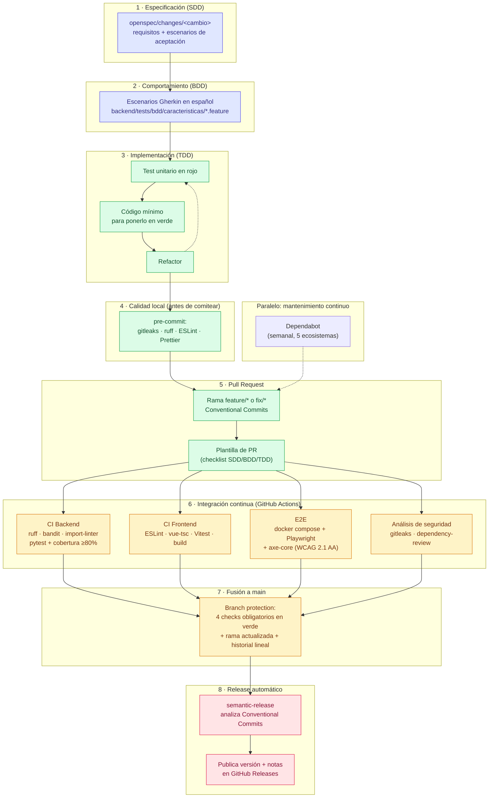

# Ciclo de desarrollo y aseguramiento de la calidad

Este documento describe, paso a paso y con el máximo detalle, cómo se
garantiza la calidad del código en este proyecto: metodología de
desarrollo, herramientas de análisis estático, pirámide de tests,
accesibilidad, integración continua, seguridad de dependencias, revisión
de Pull Requests y publicación de versiones. No es un resumen: cada
herramienta mencionada aquí existe de verdad en el repositorio (ver las
rutas de fichero entre paréntesis) y se ejecuta automáticamente, no es un
proceso manual que dependa de que alguien se acuerde de hacerlo.

## Resumen visual del flujo



## 1. Metodología: SDD → BDD → TDD

Toda funcionalidad nueva atraviesa tres niveles de especificación antes
de darse por terminada, de lo más abstracto a lo más concreto:

### 1.1. SDD (Spec-Driven Development)

Antes de escribir una sola línea de código, el cambio se especifica en
`openspec/changes/<nombre-del-cambio>/`: qué problema resuelve, qué
requisitos tiene y qué escenarios de aceptación debe cumplir. La
configuración de este flujo vive en `openspec/config.yaml`, que fija el
contexto del proyecto (arquitectura, stack, convenciones de idioma) para
que las specs generadas sean coherentes con el resto del código, y reglas
explícitas — por ejemplo, toda propuesta de cambio de riesgo (migraciones,
autenticación) debe incluir un plan de rollback, y toda spec debe indicar
si toca `dominio`, `aplicacion`, `infraestructura` o `interfaces`.

### 1.2. BDD (Behavior-Driven Development)

Los escenarios de aceptación de la spec se traducen a **Gherkin en
español** (`# language: es`), en
`backend/tests/bdd/caracteristicas/*.feature`. Son la fuente de verdad de
"qué debe hacer la funcionalidad" en lenguaje natural, ejecutable:

```gherkin
# language: es
Característica: Crear movimiento
  Escenario: Alta de un gasto con categoría existente
    Dado que existe la cuenta "ES00..." con saldo 100.00
    Cuando registro un gasto de 25.50 en la categoría "Alimentación"
    Entonces el saldo de la cuenta es 74.50
```

Estos escenarios se ejecutan con **`pytest-bdd`**
(`backend/tests/bdd/definiciones_pasos/*.py`), que conecta cada línea
Gherkin con una función Python real. Si el comportamiento implementado no
coincide con lo descrito en el escenario, el test falla — el Gherkin no es
documentación que pueda quedarse desactualizada, es ejecutable.

### 1.3. TDD (Test-Driven Development)

Cada paso de la implementación se escribe siguiendo el ciclo clásico
**rojo → verde → refactor**: primero un test unitario que falla
(`backend/tests/unitarios/`), después el código mínimo necesario para que
pase, y por último una pasada de refactor sin cambiar el comportamiento
(con la red de seguridad del test ya en verde). Esto aplica tanto al
backend (`pytest`) como al frontend (`Vitest`, `frontend/src/**/__tests__/`).

## 2. Calidad de código estático

### 2.1. En local, antes de comitear (`pre-commit`)

El repositorio tiene `pre-commit` configurado
(`.pre-commit-config.yaml`) para que ciertos problemas se detecten
**antes** de que el commit llegue a existir, no después en CI:

| Hook | Qué comprueba | Alcance |
|---|---|---|
| `gitleaks` | Secretos, claves API, tokens, credenciales accidentalmente comiteados | Todo el repo |
| `ruff` (`--fix`) | Lint de Python: estilo, imports sin usar, convenciones de nombres (`pep8-naming`) | `backend/` |
| `ruff-format` | Formato de código Python | `backend/` |
| `eslint-frontend` | Lint de TypeScript/Vue, incluida la regla `naming-convention` | `frontend/**/*.{ts,vue}` |
| `prettier-frontend` | Formato de TypeScript/Vue/CSS | `frontend/**/*.{ts,vue,css}` |

Se instala una sola vez (`uv tool install pre-commit && pre-commit
install`) y a partir de ahí corre automáticamente en cada `git commit`,
bloqueándolo si algo no pasa.

### 2.2. Arquitectura: `import-linter`

El backend sigue arquitectura hexagonal (`dominio → aplicacion →
infraestructura → interfaces`, ver
[`docs/adr/0001-arquitectura-hexagonal-y-ddd.md`](adr/0001-arquitectura-hexagonal-y-ddd.md)).
La regla de dependencias entre capas — por ejemplo, que `dominio` no
puede importar nada de `infraestructura` — no es una convención de
confianza: **`import-linter`** (`uv run lint-imports`) la verifica
automáticamente contra el grafo de imports real del proyecto, y falla la
build si se rompe, tanto en local como en CI.

### 2.3. Análisis de seguridad estático del código

- **`bandit`** (`uv run bandit -r src -q`): analiza el código Python en
  busca de patrones inseguros conocidos (inyección SQL, uso de
  `eval`/`pickle` sin control, contraseñas hardcodeadas, etc.).
- **`gitleaks`**: además de en `pre-commit`, se ejecuta también en CI
  (ver más abajo) sobre el historial completo de cada PR.

## 3. Pirámide de tests

### 3.1. Backend (`pytest`)

| Capa | Ruta | Qué verifica |
|---|---|---|
| Unitarios | `backend/tests/unitarios/` | Lógica de dominio y aplicación en aislamiento (TDD) |
| Integración | `backend/tests/integracion/` | Repositorios reales contra MySQL, comportamiento end-to-end de un caso de uso |
| BDD | `backend/tests/bdd/` | Escenarios Gherkin (ver §1.2) |
| Contrato | `backend/tests/contrato/` | **Schemathesis** genera peticiones automáticamente a partir del esquema OpenAPI y comprueba que las respuestas reales cumplen ese contrato (códigos de estado documentados, cabeceras como `Allow` en 405, formas de los cuerpos JSON) |

Se ejecutan todos juntos con cobertura:

```bash
uv run pytest --cov=src/gestor_gastos --cov-report=term-missing --cov-fail-under=80
```

El `--cov-fail-under=80` hace que la build falle si la cobertura global
baja del 80&nbsp;%, no solo informa de un número.

### 3.2. Frontend

- **Vitest** (`pnpm test:unit run`): tests unitarios de componentes Vue,
  composables y utilidades (`frontend/src/**/__tests__/*.spec.ts`).
- **Playwright** (`pnpm exec playwright test`): tests end-to-end contra la
  aplicación real levantada con Docker (`frontend/e2e/*.spec.ts`), cubriendo
  los flujos completos de usuario (crear movimiento, importar un extracto,
  gestionar cuentas y categorías, etc.).
- **`vue-tsc`** (`pnpm type-check`): comprobación de tipos de TypeScript en
  modo estricto sobre todo el proyecto.

## 4. Accesibilidad (WCAG 2.1 AA)

La accesibilidad no es una revisión manual puntual: es un conjunto de
tests automatizados que se ejecutan en cada PR, como cualquier otro test.

`frontend/e2e/accesibilidad.spec.ts` usa **`@axe-core/playwright`** para
auditar automáticamente cada pantalla principal (Dashboard, Movimientos,
Importar, Historial, Resumen anual, Gestión → Cuentas/Categorías) contra
las reglas `wcag2a`, `wcag2aa`, `wcag21a` y `wcag21aa`, y falla el test si
hay alguna violación (contraste insuficiente, etiquetas ARIA ausentes,
orden de foco incorrecto, etc.). Esto se hace:

- **En modo claro y en modo oscuro**, por separado, para cada ruta.
- También sobre el **manual de usuario interactivo** y los **tours
  guiados** (basados en `driver.js`, ver
  [`docs/adr/0002-driverjs-para-el-manual-de-usuario-interactivo.md`](adr/0002-driverjs-para-el-manual-de-usuario-interactivo.md)),
  no solo sobre las pantallas estáticas — incluyendo una espera explícita
  a que la animación de aparición del popover termine (`opacity: 1`) antes
  de auditar, para evitar falsos positivos de contraste captados a mitad
  de una transición.

## 5. Integración continua (GitHub Actions)

Cuatro workflows se disparan en **cada Pull Request** y en cada push a
`main` (`.github/workflows/`), sin filtro de rutas: aunque un PR solo
toque el backend, los cuatro corren igualmente, porque con "ramas
actualizadas" obligatorio en la protección de `main` (ver §6), un check
que no llegara a dispararse se quedaría pendiente para siempre y
bloquearía la fusión.

### `ci-backend.yml` — job `calidad-y-tests-backend`

1. Instala dependencias con `uv sync --frozen`.
2. `ruff check .` (lint) y `ruff format --check .` (formato).
3. `bandit -r src -q` (seguridad estática).
4. `lint-imports` (contrato de capas hexagonales).
5. `alembic upgrade head` contra un MySQL de servicio real levantado por
   el propio workflow (no mockeado).
6. `pytest` completo con cobertura (§3.1), `--cov-fail-under=80`.
7. Publica el informe de cobertura como artefacto.

### `ci-frontend.yml` — job `calidad-y-tests-frontend`

1. Instala dependencias con `pnpm install --frozen-lockfile`.
2. `eslint .` (incluye `naming-convention`).
3. `vue-tsc --build` (tipos).
4. `vitest run` (unitarios).
5. `vite build` (que el build de producción compile sin errores).

### `e2e.yml` — job `playwright`

1. Levanta la aplicación **real** completa con `docker compose up -d
   --build` (MySQL + backend + frontend), no una versión simulada.
2. Espera activamente a que el backend responda en
   `/api/v1/salud` antes de continuar.
3. Instala Playwright con sus navegadores (`--with-deps chromium`).
4. Ejecuta toda la suite E2E, incluida accesibilidad (§4).
5. Publica el informe HTML de Playwright como artefacto si algo falla.
6. Apaga la pila (`docker compose down`) al terminar, pase lo que pase.

### `security-scan.yml` — jobs `gitleaks` y `revision-dependencias`

- **`gitleaks`**: escanea el historial completo de commits del PR en
  busca de secretos. Se excluye para PRs abiertas por Dependabot, porque
  su token de solo lectura no puede listar los commits vía API y sus
  bumps de lockfile no son un vector realista de filtración de secretos.
- **`dependency-review-action`**: en cada PR, compara las dependencias
  añadidas/actualizadas contra la base de datos de vulnerabilidades
  conocidas de GitHub y falla si se introduce alguna de severidad `high`
  o superior.

### `release.yml` — job `release` (solo en push a `main`)

Ver §8.

## 6. Pull Requests y protección de `main`

- **Estrategia de ramas**: GitHub Flow. `main` siempre desplegable, sin
  pushes directos — **todo** entra por Pull Request.
- **Nomenclatura**: `feature/<slug>` o `fix/<slug>`, slug en español
  (p. ej. `feature/crear-gasto`).
- **Plantilla obligatoria** (`.github/PULL_REQUEST_TEMPLATE.md`): tipo de
  cambio, cómo probarlo, y un checklist que obliga a confirmar
  explícitamente que la funcionalidad tiene su spec SDD y sus escenarios
  BDD, que se ha seguido TDD, que `import-linter`/`ruff`/`bandit`/`eslint`
  pasan en local, que los identificadores nuevos están en español, que no
  se han expuesto secretos y que los commits siguen Conventional Commits.
- **Protección de rama `main`** (configurada en GitHub, no solo
  documentada):
  - 4 checks obligatorios en verde antes de poder fusionar:
    `calidad-y-tests-backend`, `calidad-y-tests-frontend`, `playwright`,
    `gitleaks`.
  - La rama debe estar **actualizada** con `main` antes de fusionar
    (`strict: true`), para que el check se ejecute contra el código real
    que va a quedar en `main`, no contra una versión antigua.
  - **Historial lineal obligatorio** (sin merge commits de fusión
    "normales" en `main`, solo squash o fast-forward).
  - Prohibido `force-push` y borrado de la rama protegida, incluso para
    administradores (`enforce_admins: true`).
- **Clean Code asistido**: antes de fusionar un PR no trivial, existe la
  skill `/revision-clean-code` para una revisión asistida por IA de
  nombres, responsabilidad única y fugas entre capas que las reglas
  automáticas (ruff, ESLint) no detectan por ser más una cuestión de
  diseño que de sintaxis.

## 7. Seguridad y mantenimiento de dependencias (Dependabot)

`Dependabot` (`.github/dependabot.yml`) revisa **semanalmente** cinco
ecosistemas de dependencias de forma independiente:

| Ecosistema | Directorio | Qué cubre |
|---|---|---|
| `uv` | `/backend` | Dependencias Python |
| `npm` | `/frontend` | Dependencias del frontend |
| `npm` | `/` | Herramientas de versionado/release (`semantic-release` y plugins) |
| `docker` | `/backend`, `/frontend` | Imágenes base de los `Dockerfile` |
| `github-actions` | `/` | Versiones de las actions usadas en los workflows |

Cada actualización llega como una PR normal, con el mismo prefijo de
commit `chore` y sujeta exactamente a los mismos checks obligatorios que
cualquier otro PR (§5, §6) — una dependencia no se actualiza nunca "a
ciegas". Además, GitHub genera **alertas de seguridad de Dependabot**
automáticas para CVEs conocidas en cualquier dependencia del árbol
(directa o transitiva), independientemente de si hay o no una PR
automática disponible para solucionarlas.

## 8. Releases automáticos (`semantic-release`)

Al fusionar a `main`, el job `release` de `release.yml`:

1. Analiza los mensajes de commit desde el último release, siguiendo
   **[Conventional Commits](https://www.conventionalcommits.org/es/)**
   (`feat:` → minor, `fix:` → patch, `feat!:`/`BREAKING CHANGE:` → major).
2. Calcula la siguiente versión semántica automáticamente.
3. Publica un **release de GitHub** agrupado por categorías (✨
   Novedades, 🐛 Corregido, 🔧 Mejoras, ⚙️ Cambios internos), sin comitear
   ningún fichero de vuelta a `main` (que es una rama protegida sin pushes
   directos).
4. La propia aplicación lee la versión y el historial de cambios **en
   vivo** desde la API de GitHub (`frontend/src/api/github.ts`), así que
   lo que se ve en la aplicación siempre coincide exactamente con la
   última release publicada, sin fichero de changelog que pueda
   desincronizarse.

Antes de dar la versión final por buena, existe la skill
`/generar-release-notes` para reescribir el borrador automático en prosa
narrativa (estilo "Novedades de la versión" de Visual Studio Code) en
`docs/release-notes/`, pensada para que la lea una persona, no solo un
changelog técnico.

## 9. Resumen: todas las herramientas de un vistazo

| Herramienta | Qué hace | Cuándo corre |
|---|---|---|
| `pre-commit` | Orquesta los hooks locales | Cada `git commit` |
| `gitleaks` | Detección de secretos | Local (pre-commit) + CI (`security-scan.yml`) |
| `ruff` | Lint + formato Python (incluye `pep8-naming`) | Local + `ci-backend.yml` |
| `bandit` | SAST Python | Local (manual) + `ci-backend.yml` |
| `import-linter` | Contrato de capas hexagonales | Local (manual) + `ci-backend.yml` |
| `pytest` + `pytest-bdd` | Unitarios, integración, BDD | `ci-backend.yml` |
| `Schemathesis` | Tests de contrato contra el esquema OpenAPI | `ci-backend.yml` |
| `ESLint` (+ `naming-convention`) | Lint TypeScript/Vue | Local (pre-commit) + `ci-frontend.yml` |
| `Prettier` | Formato TypeScript/Vue/CSS | Local (pre-commit) |
| `vue-tsc` | Comprobación de tipos | `ci-frontend.yml` |
| `Vitest` | Tests unitarios frontend | `ci-frontend.yml` |
| `Playwright` | Tests E2E contra la app real | `e2e.yml` |
| `@axe-core/playwright` | Accesibilidad WCAG 2.1 AA | `e2e.yml` |
| `dependency-review-action` | CVEs en dependencias nuevas de cada PR | `security-scan.yml` |
| `Dependabot` | Actualización semanal de dependencias + alertas de seguridad | Semanal (independiente de PRs) |
| `semantic-release` | Versionado y publicación de releases | `release.yml`, solo en `main` |
| `openspec` | Especificación SDD | Antes de implementar |
| `pytest-bdd` | Ejecución de escenarios Gherkin | `ci-backend.yml` |

Cada fila de esta tabla es una comprobación automática real, no un
proceso que dependa de que una persona se acuerde de ejecutarlo a mano.
