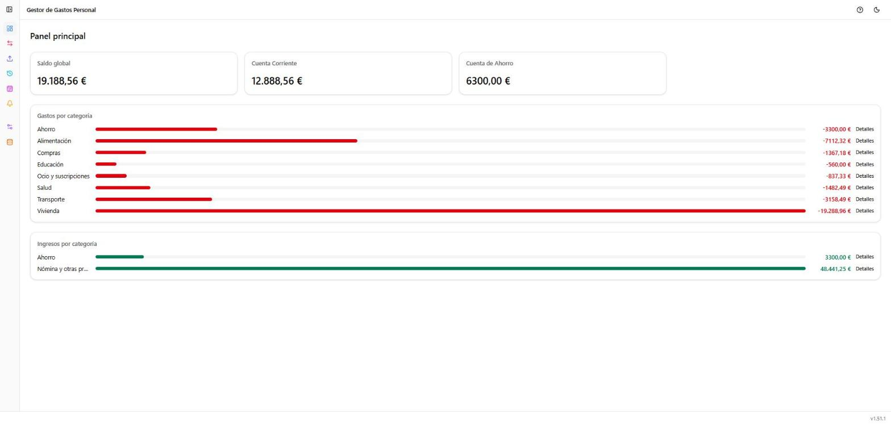
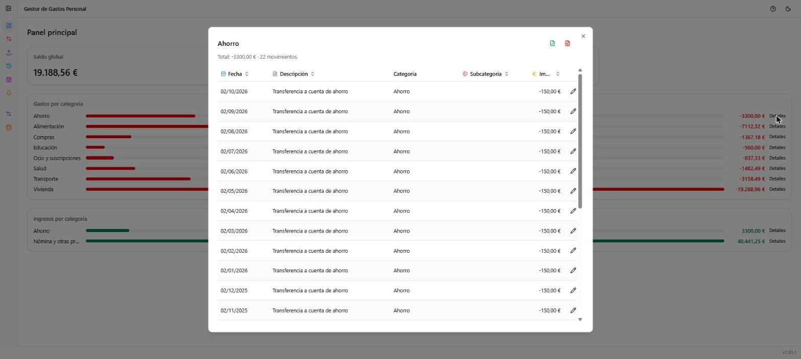

# Dashboard

**Ruta:** `/` · **Icono en el menú:** balanza (azul)

## Qué es

La pantalla de inicio de la aplicación. Da un resumen general de tu
situación financiera: saldo por cuenta y totales de gastos e ingresos del
periodo, agrupados por categoría. Es una vista de solo lectura — aquí no se
crea ni edita nada directamente, pero sirve como punto de partida para
entender de dónde vienen los números antes de ir a Movimientos o Historial
a profundizar.

## Qué puedes hacer aquí

### Saldo global y saldo por cuenta

En la fila superior, una tarjeta con la suma del saldo de todas tus
cuentas bancarias ("Saldo global"), y una tarjeta por cada cuenta dada de
alta (ver [Gestión → Cuentas](07-gestion-cuentas.md)) con su saldo actual
por separado. Si una cuenta tiene alias, se muestra el alias; si no, el
número de cuenta.

### Gastos por categoría

Lista de categorías con gasto en el periodo actual, cada una con una barra
proporcional al total y el importe correspondiente. Pasar el ratón por
encima de una categoría muestra en un tooltip el detalle de los movimientos
que componen ese total (hasta 15 líneas, agrupadas y resumidas si hay más).

Pulsando **"Detalles"** se abre una ventana modal con la tabla completa de
movimientos de esa categoría (fecha, descripción, categoría, subcategoría e
importe), desde la que también se puede editar cada movimiento (icono de
lápiz) o exportarlos a Excel/PDF (iconos junto al título), sin salir del
Dashboard.

### Ingresos por categoría

Igual que el bloque de gastos, pero con las categorías de ingreso del
periodo.

## Notas

- Si todavía no hay ningún gasto o ingreso registrado, cada bloque muestra
  un mensaje vacío en lugar de la lista ("No hay gastos registrados
  todavía." / "No hay ingresos registrados todavía.").
- Los datos que se ven aquí dependen de todas las cuentas y movimientos
  existentes; no hay un selector de rango de fechas en esta pantalla (para
  eso, ver [Movimientos](02-movimientos.md)).
