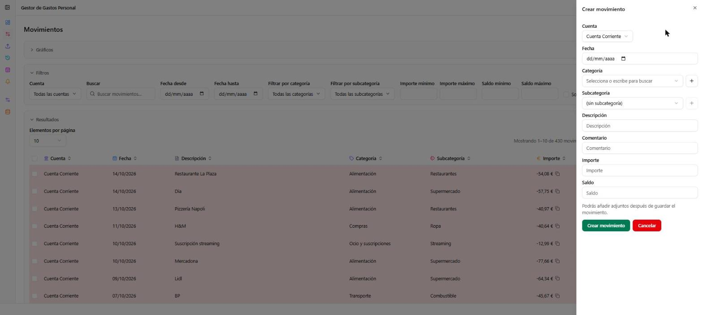
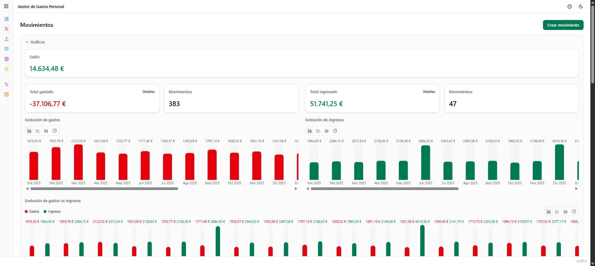
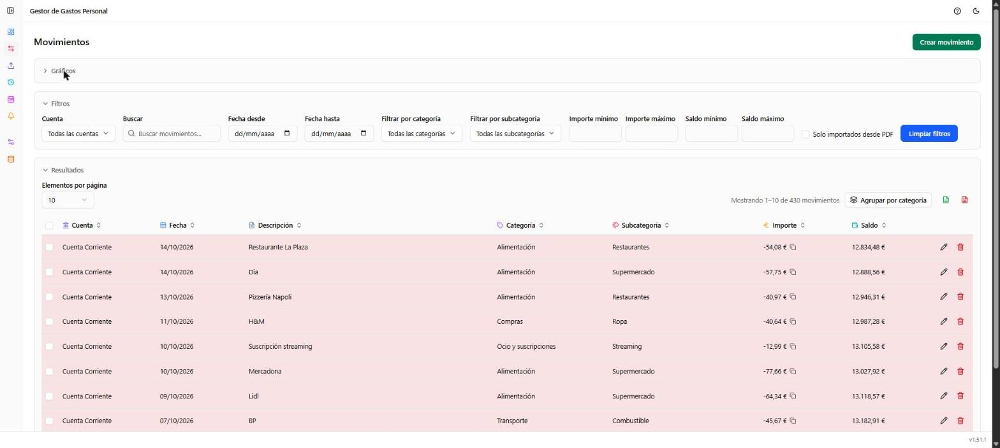

# Movimientos

**Ruta:** `/movimientos` · **Icono en el menú:** flechas cruzadas (rosa)

## Qué es

Registra, edita y filtra tus movimientos de gastos e ingresos. Es la
pantalla central de la aplicación: todo gasto o ingreso, se haya dado de
alta a mano o importado desde un Excel/PDF (ver [Importar](03-importar.md)),
termina apareciendo aquí.

## Qué puedes hacer aquí

### Crear un movimiento a mano

Botón **"Crear movimiento"**, arriba a la derecha. Abre un panel lateral
con cuenta, fecha, categoría/subcategoría (se pueden crear nuevas sobre la
marcha con el botón "+"), descripción, comentario, importe y saldo. Los
adjuntos (p. ej. el PDF de un recibo) se añaden después de guardar, desde
la edición del movimiento.

### Gráficos (bloque plegable)

- **Saldo**: el saldo resultante de los movimientos filtrados.
- **Total gastado / Total ingresado**: con un enlace "Detalles" a la lista
  de movimientos que los componen.
- **Evolución de gastos** y **Evolución de ingresos**: gráficos mensuales,
  con 4 tipos intercambiables (barras, líneas, área, circular).
- **Evolución de gastos vs ingresos**: el mismo gráfico pero comparando
  ambas series; en líneas o área se puede aislar una serie pulsando su
  nombre en la leyenda.
- **Top 10 categorías**: las categorías con mayor importe acumulado, tanto
  de gastos como de ingresos.

### Filtros

Cuenta (selección múltiple), texto libre, rango de fechas (con atajos
"mes anterior"/"mes siguiente" cuando el rango cubre un mes completo),
categoría y subcategoría (selección múltiple), importe mínimo/máximo,
saldo mínimo/máximo, y un filtro para ver solo los movimientos importados
desde PDF (útil para revisar la categoría que se les asignó
automáticamente). Un botón **"Limpiar filtros"** los restablece todos a la
vez.

### Resultados

- Tamaño de página configurable y paginación.
- **"Agrupar por categoría"**: alterna entre la tabla plana y una vista
  agrupada por categoría/subcategoría.
- **Exportar**: descarga la tabla (ya filtrada) a Excel o PDF.
- **Selección múltiple**: marca varios movimientos a la vez; al marcar
  alguno aparece una barra de acciones en bloque para cambiarles la
  categoría o eliminarlos juntos.
- **Tabla**: ordenable por columnas; cada fila tiene iconos para editar o
  eliminar. Un icono junto a la descripción indica que el movimiento se
  importó desde un PDF; el icono de clip (si aparece) abre los adjuntos del
  movimiento.

## Notas

- El saldo mostrado en cada fila es el saldo de la cuenta tras ese
  movimiento, no un cálculo en el cliente: si editas el importe de un
  movimiento antiguo, el saldo de los movimientos posteriores de esa cuenta
  no se recalcula automáticamente.
- Los filtros se aplican también a la exportación y a los totales/gráficos
  de la parte superior.
