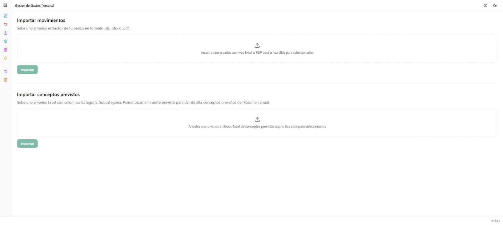

# Importar

**Ruta:** `/importar` · **Icono en el menú:** flecha hacia arriba (índigo)

## Qué es

Sube extractos bancarios en Excel o PDF para dar de alta movimientos en
bloque, sin introducirlos a mano uno a uno en [Movimientos](02-movimientos.md).
También permite dar de alta de golpe los conceptos previstos del
[Resumen anual](05-resumen-anual.md) a partir de un Excel.

## Qué puedes hacer aquí

### Importar movimientos

Arrastra (o selecciona haciendo clic) uno o varios ficheros `.xls`, `.xlsx`
o `.pdf` — se pueden mezclar formatos en la misma subida. Al pulsar
**"Importar"**:

- **Excel**: antes de confirmar nada, se abre una ventana de revisión fila
  a fila. Si alguna descripción coincide con una asociación por descripción
  ya configurada (ver [Gestión → Asociar conceptos](09-gestion-asociar-conceptos.md)),
  la categoría/subcategoría se propone automáticamente (marcada con un
  icono), pero siempre editable antes de confirmar.
- **PDF**: se procesa directamente (no tiene columna de categoría propia en
  el origen, así que la categoría se propone automáticamente por
  descripción sin paso de revisión previo).

Tras importar con éxito, aparece un resumen con cuántos movimientos se
dieron de alta y cuántos se omitieron por estar ya duplicados (misma
cuenta, fecha e importe). Si hay duplicados dudosos, se abre una
comparación lado a lado para decidir caso a caso.

### Importar conceptos previstos

Arrastra uno o varios Excel con columnas **Categoría**, **Subcategoría**,
**Periodicidad** e **Importe previsto**, para dar de alta de una vez varios
conceptos del Resumen anual (en vez de crearlos uno a uno desde esa
pantalla).

## Notas

- Las categorías y subcategorías que no existan todavía se crean
  automáticamente al importar (tanto en movimientos como en conceptos
  previstos).
- Los movimientos importados desde PDF quedan marcados como tales (icono
  en la tabla de Movimientos), para poder revisar después la categoría que
  se les asignó automáticamente.
