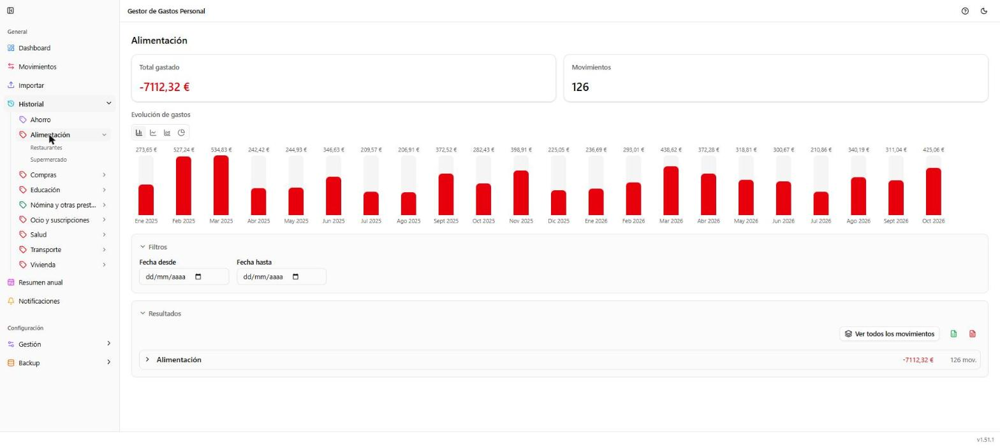

# Historial

**Ruta:** `/historial/categoria/{id}` o `/historial/subcategoria/{id}` ·
**Icono en el menú:** reloj (cian)

## Qué es

Consulta la evolución de una categoría o subcategoría a lo largo del
tiempo, con filtros y gráficos. A diferencia de Movimientos (que parte de
todos tus movimientos y los filtras), Historial parte siempre de **una**
categoría o subcategoría concreta, elegida en el propio menú lateral, que
despliega el árbol completo de categorías y subcategorías debajo de
"Historial".

Si entras sin haber elegido ninguna, la pantalla solo muestra un aviso
pidiendo que elijas una en el menú lateral.

## Qué puedes hacer aquí

### Evolución de gastos / Evolución de ingresos

El total y el número de movimientos de esa categoría o subcategoría, con
un gráfico mensual (barras, líneas, área o circular, intercambiables con
los botones de arriba). Si eliges una categoría con subcategorías, puedes
ver tanto su evolución global como la de cada subcategoría por separado
(entrando en ella desde el menú lateral).

### Filtros

Rango de fechas (desde/hasta). Al ver todos los movimientos sin agrupar
(con "Ver todos los movimientos") aparece también un buscador de texto
libre.

### Resultados

Igual que en Movimientos: tamaño de página, agrupar/desagrupar, exportar a
Excel o PDF, y la tabla de movimientos con iconos para editar (lápiz) y ver
adjuntos (clip, si el movimiento tiene alguno).

## Notas

- El menú lateral de Historial colorea el icono de cada categoría en rojo
  o verde según si predomina el gasto o el ingreso en ella.
- Pasar de una categoría a otra en el menú recarga el detalle; no hace
  falta volver atrás.
