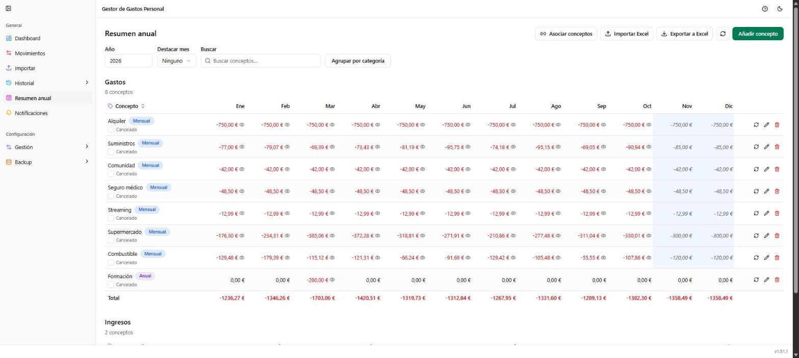

# Resumen anual

**Ruta:** `/resumen-anual` · **Icono en el menú:** calendario (fucsia)

## Qué es

Compara lo previsto con lo real, mes a mes, para cada concepto de tu
presupuesto anual (alquiler, suscripciones, nómina...). Es la pantalla de
planificación: aquí defines qué esperas gastar o ingresar cada mes, y la
aplicación lo contrasta automáticamente con los movimientos reales que ya
tengas en esa categoría.

## Qué puedes hacer aquí

### Año, Destacar mes y Buscar

Selector de año (las tablas se recargan al cambiarlo), un desplegable para
resaltar un mes concreto (sombrea su columna en toda la tabla, para
centrarte en los gastos de ese mes), y un buscador que filtra los
conceptos por nombre, categoría o subcategoría.

### Añadir concepto

Da de alta un concepto previsto: categoría, subcategoría, periodicidad
(mensual, trimestral, semestral o anual — con periodicidad distinta de
mensual aparece también "Mes de inicio"), e importe previsto.

### Asociar conceptos

Lleva a [Gestión → Asociar conceptos](09-gestion-asociar-conceptos.md),
donde se le dice a la aplicación qué categoría/descripción real de tus
movimientos corresponde a cada concepto previsto, para que el importe
"real" se calcule solo.

### Importar Excel / Exportar a Excel

Exporta el resumen (de uno o varios años) a Excel, edítalo fuera de la
aplicación si quieres, y vuelve a importarlo: solo se actualizan las
celdas que hayan cambiado respecto a lo que ya había.

### Cargar acumulado real

Sobrescribe con el importe real de los movimientos cualquier mes de este
año que tengas ajustado a mano, en todos los conceptos a la vez (icono de
recarga circular arriba de la tabla), o concepto a concepto (mismo icono en
cada fila).

### La tabla: previsto, real, ajustado y cancelado

Cada fila es un concepto, con sus 12 columnas de mes. El importe de cada
celda se decide así, en este orden de prioridad:

1. **Ajustado** (borde punteado): un valor fijado a mano para esa celda
   concreta, pulsando directamente sobre ella.
2. **Real**: si hay movimientos de esa categoría ese mes, se suma su
   importe automáticamente.
3. **Previsto** (en cursiva): si no hay nada real todavía, se usa el
   importe previsto del concepto, como estimación.

Debajo del nombre de cada concepto hay una casilla **"Cancelado"**: si la
marcas, esa fila se muestra tachada **solo para el año que estés viendo**
(los demás años de ese mismo concepto no se ven afectados y mantienen su
propio estado). Útil para marcar visualmente una suscripción o gasto que
ya no está vigente, sin perder su histórico.

Los iconos de cada fila permiten editar el concepto, eliminarlo, o cargar
su acumulado real para el año en curso.

### Agrupar por categoría

Alterna entre ver todos los conceptos juntos (como en la captura) o
agrupados por categoría, con el total de cada una colapsable.

## Notas

- Las tablas de Gastos e Ingresos son independientes, cada una con su
  propio total por mes.
- Pasar el ratón por el nombre de un concepto muestra en un tooltip el
  saldo anual previsto frente al saldo anual actual (solo lo ya confirmado,
  sin contar lo previsto).
