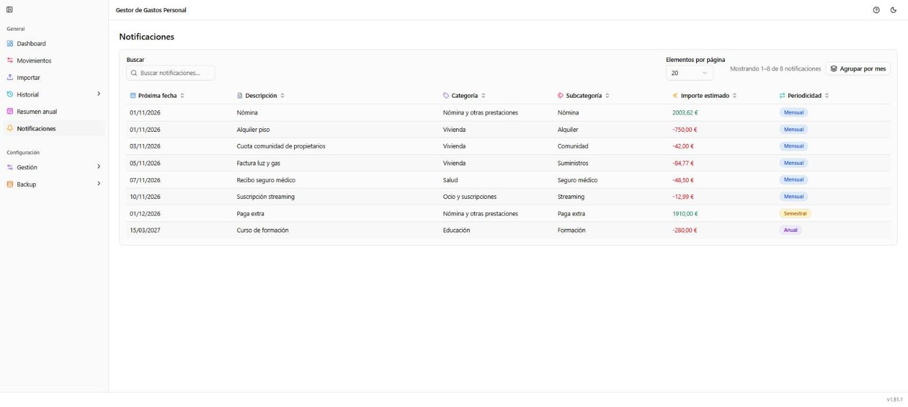

# Notificaciones

**Ruta:** `/notificaciones` · **Icono en el menú:** campana (ámbar)

## Qué es

Próximos gastos e ingresos recurrentes (suscripciones, nóminas, seguros...),
predichos a partir de tu histórico de movimientos de los últimos dos años.
Es una vista de solo lectura, puramente informativa: no se puede crear ni
editar nada desde aquí, solo anticipar qué va a cobrarte o ingresarte
pronto.

## Qué puedes hacer aquí

### Buscar

Filtra la lista por descripción, categoría o periodicidad.

### Agrupar por mes

Alterna entre la tabla plana (como en la captura, ordenada por "Próxima
fecha") y una vista agrupada por el mes de la próxima ocurrencia, con el
total de gastos e ingresos previstos de cada mes.

### Próximos eventos (la tabla)

Cada fila es un gasto o ingreso recurrente detectado automáticamente, con
su próxima fecha estimada, descripción, categoría/subcategoría, importe
estimado y periodicidad (mensual, trimestral, semestral o anual). Se puede
ordenar por cualquier columna pulsando su cabecera.

## Notas

- Solo aparecen aquí las categorías que ya sigues en [Resumen anual](05-resumen-anual.md)
  (es decir, que tienen un concepto previsto configurado): si falta algo
  que esperabas ver, revisa que exista su concepto previsto.
- La paginación solo aparece si hay más notificaciones de las que caben en
  una página.
