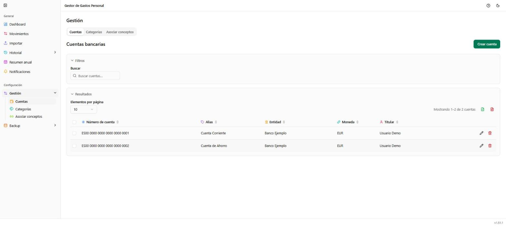

# Gestión → Cuentas

**Ruta:** `/gestion/cuentas` · **Icono en el menú:** cartera (ámbar)

## Qué es

Administra tus cuentas bancarias: las que aparecen como tarjetas en el
[Dashboard](01-dashboard.md) y como opción de "Cuenta" al crear o filtrar
movimientos. Es la primera de las tres pestañas de **Gestión** (junto con
[Categorías](08-gestion-categorias.md) y
[Asociar conceptos](09-gestion-asociar-conceptos.md)).

## Qué puedes hacer aquí

### Crear cuenta

Botón **"Crear cuenta"**, arriba a la derecha. Pide número de cuenta
(obligatorio) y, opcionalmente, alias, entidad bancaria, moneda y titular.
El alias es lo que se muestra en el resto de la aplicación cuando existe
(si no, se usa el número de cuenta).

### Buscar

Filtra la tabla por número de cuenta, alias, entidad, moneda o titular.

### Selección múltiple y acciones en bloque

Marca varias cuentas a la vez (casillas de la primera columna); al marcar
alguna aparece una barra para eliminarlas todas juntas.

### Exportar

Descarga la tabla (ya filtrada) a Excel o PDF, con los iconos junto al
contador de resultados.

### Tabla de cuentas

Cada fila tiene iconos para editar o eliminar esa cuenta en concreto.

## Notas

- Eliminar una cuenta que todavía tiene movimientos asociados no está
  permitido directamente: primero hay que mover o eliminar esos
  movimientos.
- El número de cuenta debe ser único; la aplicación lo usa también para
  detectar a qué cuenta pertenece un extracto importado desde
  [Importar](03-importar.md) cuando coincide con uno ya existente.
