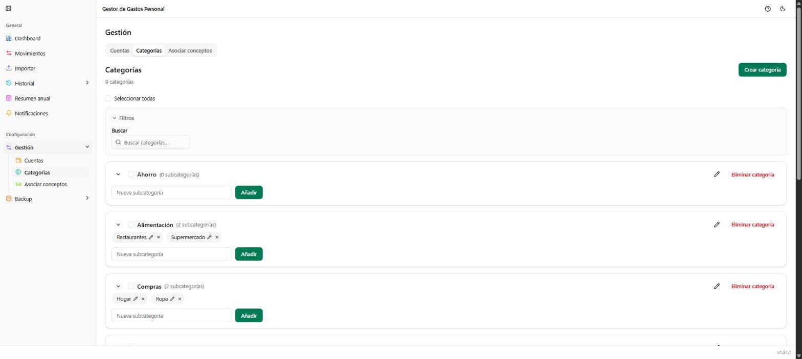

# Gestión → Categorías

**Ruta:** `/gestion/categorias` · **Icono en el menú:** etiquetas (teal)

## Qué es

Administra las categorías y subcategorías que se usan en toda la
aplicación (Movimientos, Historial, Resumen anual...). Segunda pestaña de
**Gestión**.

## Qué puedes hacer aquí

### Crear categoría

Botón **"Crear categoría"**, arriba a la derecha. Solo pide el nombre; las
subcategorías se añaden después, desde la propia tarjeta de la categoría.

### Buscar

Filtra por nombre de categoría o subcategoría (si una subcategoría
coincide, se muestra la tarjeta de su categoría).

### Selección múltiple y acciones en bloque

"Seleccionar todas" o las casillas individuales de cada tarjeta marcan
varias categorías a la vez para eliminarlas en bloque.

### Cada tarjeta de categoría

- Icono de lápiz: renombra la categoría.
- **"Eliminar categoría"**: la borra (solo si no la usa ningún movimiento
  ni concepto previsto; si la usa, hay que reasignarlos antes).
- Cada subcategoría es una etiqueta con su propio icono de editar (lápiz) y
  de eliminar (aspa).
- Campo **"Nueva subcategoría"** + botón **"Añadir"**: da de alta
  subcategorías nuevas dentro de esa categoría.

## Notas

- Una subcategoría solo existe dentro de su categoría; no se puede mover a
  otra categoría sin recrearla.
- Igual que con las cuentas, no se puede eliminar una categoría o
  subcategoría que todavía esté en uso.
