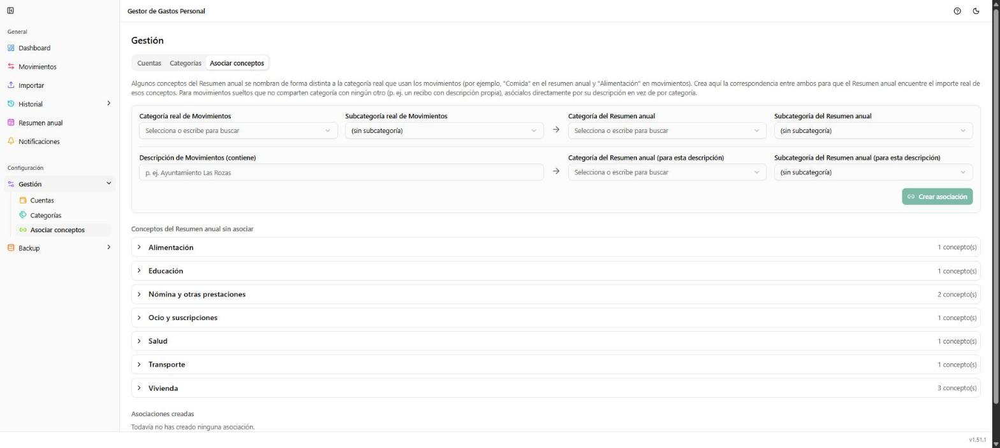

# Gestión → Asociar conceptos

**Ruta:** `/gestion/conceptos` · **Icono en el menú:** enlace (lima)

## Qué es

Hace de puente entre los conceptos previstos del
[Resumen anual](05-resumen-anual.md) y las categorías/subcategorías reales
que usan tus [Movimientos](02-movimientos.md), cuando no se llaman igual.
Tercera pestaña de **Gestión**. Sin esta asociación, el Resumen anual no
sabría qué movimientos reales corresponden a un concepto previsto que se
nombra de otra forma.

## Qué puedes hacer aquí

Hay dos formas de asociar, independientes entre sí:

### Asociar por categoría

Para cuando un concepto del Resumen anual se llama distinto a su categoría
real (p. ej. "Comida" en el resumen anual y "Alimentación" en Movimientos).
Elige la categoría/subcategoría real de Movimientos y la categoría/
subcategoría del Resumen anual que debe corresponder con ella, y pulsa
**"Crear asociación"**.

### Asociar por descripción

Para movimientos sueltos que no comparten categoría con ningún otro (p.
ej. un recibo con descripción propia, como "Ayuntamiento Las Rozas").
Escribe un fragmento de la descripción a buscar y la categoría/subcategoría
del Resumen anual a la que debe sumarse cualquier movimiento cuya
descripción lo contenga.

### Conceptos del Resumen anual sin asociar

Lista, agrupada por categoría, de los conceptos previstos que todavía no
tienen ninguna asociación. Pulsar uno de la lista rellena el formulario de
"Asociar por categoría" con sus datos, para no tener que teclearlos a mano.

### Asociaciones creadas / Asociaciones por descripción creadas

Las dos tablas de abajo, con las asociaciones ya existentes de cada tipo,
editables o eliminables desde ahí.

## Notas

- Un mismo concepto puede tener a la vez una asociación por categoría y
  varias por descripción: sus importes se suman sin duplicarse, aunque un
  movimiento coincida con más de una.
- En el conjunto de ejemplo de este manual no se ha creado ninguna
  asociación a propósito, porque los conceptos previstos usan ya las
  mismas categorías que los movimientos — por eso la lista de "sin
  asociar" aparece llena y la de "Asociaciones creadas" vacía.
