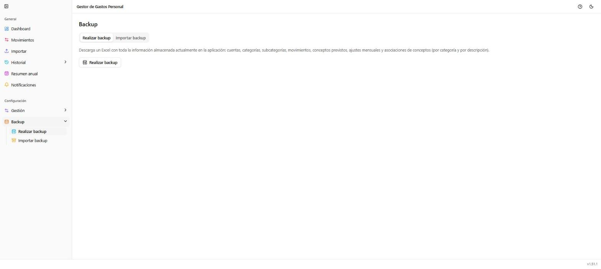

# Backup → Realizar backup

**Ruta:** `/backup/realizar` · **Icono en el menú:** base de datos con flecha hacia atrás (cielo)

## Qué es

Descarga una copia de seguridad completa de todos tus datos en un único
fichero Excel. Primera de las dos pestañas de **Backup**.

## Qué puedes hacer aquí

Pulsar **"Realizar backup"** descarga un `.xlsx` con toda la información
almacenada actualmente: cuentas, categorías, subcategorías, movimientos,
conceptos previstos, ajustes mensuales y asociaciones de conceptos (por
categoría y por descripción), cada bloque en su propia hoja.

## Notas

- Es el fichero que espera [Importar backup](11-backup-importar.md) para
  restaurar: conviene generarlo antes de cualquier operación que vaya a
  sustituir datos (como una propia importación de backup, o pruebas con
  datos de ejemplo).
- A diferencia de la exportación de [Movimientos](02-movimientos.md) o del
  [Resumen anual](05-resumen-anual.md) (que exportan solo lo filtrado o lo
  visible), este backup es siempre completo y de toda la aplicación.
