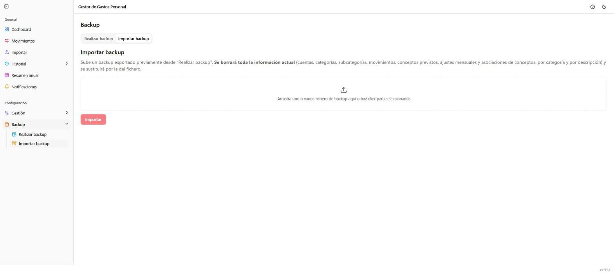

# Backup → Importar backup

**Ruta:** `/backup/importar` · **Icono en el menú:** base de datos con flecha de restaurar (ámbar)

## Qué es

Restaura un backup generado previamente con
[Realizar backup](10-backup-realizar.md). Segunda pestaña de **Backup**.

## ⚠️ Acción destructiva

Al importar, **se borra toda la información actual** (cuentas, categorías,
subcategorías, movimientos, conceptos previstos, ajustes mensuales y
asociaciones de conceptos) y se sustituye por la del fichero. No es una
fusión ni una actualización parcial: es un reemplazo total.

## Qué puedes hacer aquí

Arrastra (o selecciona) el fichero de backup y pulsa **"Importar"**. Antes
de aplicarse, pide una confirmación explícita recordando que es
destructivo. Tras importar con éxito, aparece un resumen y un botón para
ir al Dashboard (la página se recarga por completo, ya que todo el estado
cargado en memoria queda obsoleto).

## Notas

- Solo admite un fichero a la vez: si se sueltan varios, se usa el
  primero.
- No hay confirmación "por partes" — revisa bien que el fichero es el
  correcto antes de confirmar, ya que no hay forma de deshacer la
  sustitución salvo importando un backup anterior.
