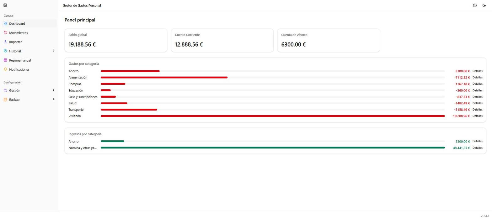

# Manual de usuario — Gestor de Gastos Personal

Una página por cada opción del menú lateral, con el detalle de qué hace y
qué se puede hacer en cada pantalla. Las capturas usan el conjunto de
**datos de ejemplo** (ficticios) que genera
`backend/src/gestor_gastos/scripts/sembrar_datos_demo.py` — ver la sección
"Puesta en marcha (Docker)" del [README principal](../../README.md).

## Secciones de uso diario

1. [Dashboard](01-dashboard.md)
2. [Movimientos](02-movimientos.md)
3. [Importar](03-importar.md)
4. [Historial](04-historial.md)
5. [Resumen anual](05-resumen-anual.md)
6. [Notificaciones](06-notificaciones.md)

## Configuración

7. [Gestión → Cuentas](07-gestion-cuentas.md)
8. [Gestión → Categorías](08-gestion-categorias.md)
9. [Gestión → Asociar conceptos](09-gestion-asociar-conceptos.md)
10. [Backup → Realizar backup](10-backup-realizar.md)
11. [Backup → Importar backup](11-backup-importar.md)
